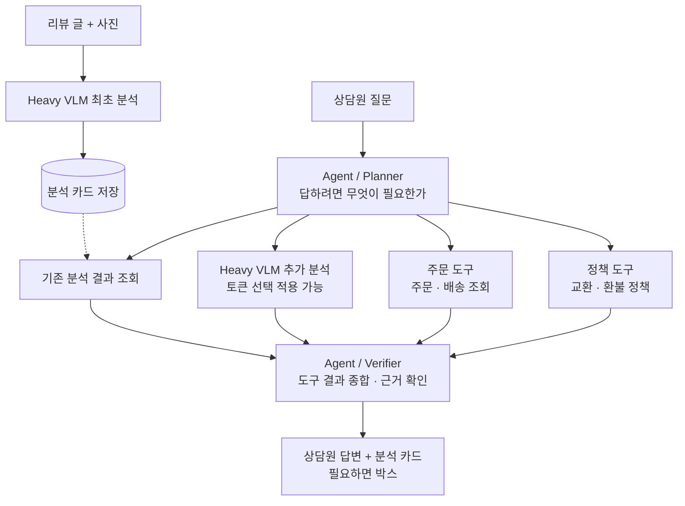

<div align="center">


# CluVi

사진 민원을 읽고 CS 상담원을 돕는 멀티모달 VQA · 에이전트


**실험 레포** &nbsp; [jimni3155](https://github.com/CluVi-prometheus/jimni3155) · [joungjubinn](https://github.com/CluVi-prometheus/joungjubinn) · [vmgfh878-art](https://github.com/CluVi-prometheus/vmgfh878-art)<br />
**문서** &nbsp; [팀이 맞춘 것](docs/agreements.md) · [서비스 구조](docs/architecture.md) · [결과 비교](docs/results.md)

<sub>프로메테우스 6팀 · 2026</sub>

</div>

---

## 무엇을 만드나

고객이 올린 리뷰 글과 사진을 보고 **무엇이 문제인지(결함)**, **어느 부위인지(부위)**, **사진 어디에 보이는지(박스)** 를 분석 카드로 냅니다. 상담원이 이어서 질문하면 에이전트가 분석 카드와 주문 · 정책 조회 결과를 근거로 답합니다. 연구 목표는 정확도를 지키면서 VLM 추론 비용을 줄이는 것입니다.

기술: 모델 PyTorch · Transformers · PEFT, 서버 FastAPI (계획), 화면 React + TypeScript (계획)

## 서비스 흐름



8차 회의(11/10) 그림입니다. 칸별 역할은 [`docs/architecture.md`](docs/architecture.md)에 있습니다.

## 레포 구성

| 레포 | 하는 일 | 운영 |
|---|---|---|
| `cluvi` (여기) | 팀이 맞춘 것, 결과 비교, 서비스 | `main`은 PR로만 |
| 개인 레포 3개 | 각자 베이스라인 · 실험 코드 | 각자 자유 |

```text
cluvi/
├── docs/       팀이 맞춘 것 · 서비스 구조 · 결과 비교
├── service/    분석 · 에이전트 · 도구 · API (12/22~)
└── web/        상담원 화면 (1/9~)
```

지금은 베이스라인 실험 단계라 `service/` · `web/`은 자리만 있습니다.

## 일정

1차 보고서 기준이며, 바뀌면 여기와 마일스톤을 같이 고칩니다.

| 기간 | 내용 | 마일스톤 |
|---|---|---|
| 10/27 ~ 11/13 | 베이스라인 (개인 레포) | |
| 11/14 ~ 12/8 | 토큰 선택 실험 (Cascade는 유지 여부 논의 중) | 토큰 선택 실험 |
| 12/9 ~ 12/21 | 시험 기간 | |
| 12/22 ~ 1/8 | 에이전트 · 목업 도구 · 백엔드 API | 에이전트 · API |
| 1/9 ~ 1/22 | 상담원 VQA 데모 통합 · 전체 평가 | 데모 통합 · 평가 |
| 1/23 ~ 1/30 | 최종 정리 · 발표 · 제출 | 최종 제출 |

## 작업 방법

- `main`에는 직접 push할 수 없고 PR로 합칩니다. Squash 머지만 되므로 **PR 제목이 `main`의 커밋 한 줄**이 됩니다. 제목은 `[파트] 내용` (예: `[에이전트] Planner 도구 선택`), 파트 이름은 라벨과 같습니다.
- 승인 1명이 기본입니다. 급하거나 사소한 변경은 승인 없이 머지할 수 있어요 (관리자 우회). 그럴 땐 PR에 이유를 한 줄 남겨 주세요.
- 리뷰 전이면 Draft PR로 올립니다. 브랜치 이름은 자유 (소문자 권장, 예: `agent-planner`), 머지되면 자동 삭제됩니다.
- 이슈는 여러 날 걸리거나 논의가 필요한 일에만 씁니다. 팀이 정해야 진행되는 일에는 `결정 필요` 라벨을 붙입니다.
- 데모 · 최종 시점은 태그로 남깁니다 (`demo`, `v1.0`). develop 브랜치는 두지 않습니다.
- 위 규칙은 GitHub 설정(Settings → Rules)이 걸고 있습니다. 같은 내용의 사본: [`.github/rulesets/main.json`](.github/rulesets/main.json)

| 라벨 종류 | 라벨 |
|---|---|
| 파트 | `모델` · `데이터` · `에이전트` · `서버` · `화면` · `문서` · `공통` |
| 유형 | `작업` · `버그` |
| 상태 | `결정 필요` |

## 데이터 · 모델

- 데이터셋은 Hugging Face `CluVi-prometheus/cesamard-defect` · `cesamard-defect-v2` (비공개)입니다. 아마존 고객이 올린 사진이 들어 있어 **공개하지 않습니다.**
- 모델 · 체크포인트를 어떻게 올릴지는 베이스라인 실험 뒤에 정합니다.

## 공개 레포라 올리면 안 되는 것

- 데이터 · 고객 사진 · 리뷰 원문 · 예측 결과 파일 · 체크포인트 · `.env` · Hugging Face 토큰. **PR 본문과 캡처도 마찬가지**입니다.
- 사진 파일은 `.gitignore`가 기본으로 막습니다. 직접 만든 그림만 `docs/assets/` · `web/src/assets/` · `web/public/`에 둡니다.
- 토큰이 든 커밋은 GitHub가 push 단계에서 막습니다 (Push protection).
