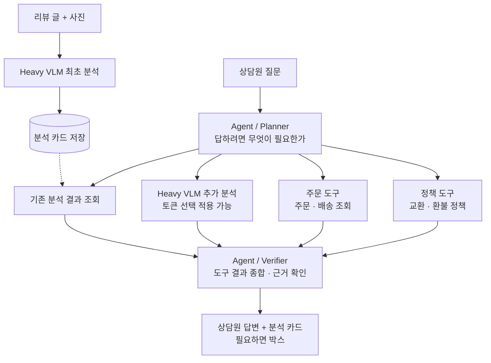

<div align="center">


# CluVi

사진 민원을 읽고 CS 상담원을 돕는 멀티모달 VQA · 에이전트


**실험 레포** &nbsp; [jimni3155](https://github.com/CluVi-prometheus/jimni3155) · [joungjubinn](https://github.com/CluVi-prometheus/joungjubinn) · [vmgfh878-art](https://github.com/CluVi-prometheus/vmgfh878-art)<br />
**문서** &nbsp; [팀이 맞춘 것](docs/agreements.md) · [서비스 구조](docs/architecture.md) · [결과 비교](experiments/README.md)<br />
**데이터** &nbsp; Hugging Face `CluVi-prometheus` (비공개)

<sub>프로메테우스 6팀 · 2026</sub>

</div>

---

## 무엇을 만드나

고객이 올린 리뷰 글과 사진을 보고 **무엇이 문제인지(결함)**, **어느 부위인지(부위)**, **사진 어디에 보이는지(박스)** 를 분석 카드로 냅니다. 상담원이 이어서 질문하면 에이전트가 분석 카드와 주문 · 정책 조회 결과를 근거로 답합니다. 연구 목표는 정확도를 지키면서 VLM 추론 비용을 줄이는 것입니다.

## 레포 구성

| 레포 | 하는 일 | 운영 |
|---|---|---|
| `cluvi` (여기) | 팀이 맞춘 약속, 서비스 (에이전트 · API · 화면), 결과 비교 | `main`은 PR로만 |
| 개인 레포 3개 | 각자 베이스라인 · 실험 코드 | 각자 자유 |

지금은 베이스라인 실험 단계라 서비스 폴더는 틀만 있습니다. 개인 레포에서 실험 결과를 맞춰 본 뒤 채웁니다.

```text
cluvi/
├── docs/
│   ├── agreements.md     팀이 똑같이 맞추기로 한 것 (백본 · 데이터 · 출력 카드 · 평가지표)
│   └── architecture.md   서비스 흐름 (8차 회의 그림)
├── service/
│   ├── analysis/         최초 분석: Heavy VLM → 분석 카드 저장
│   ├── agent/            Planner · Verifier
│   ├── tools/            기존 결과 조회 · VLM 추가 분석 · 주문 · 정책
│   └── api/              FastAPI 서버
├── web/                  상담원 화면 (React + TypeScript)
└── experiments/          개인 레포 결과를 모아 비교
```

## 서비스 흐름



자세한 칸별 역할은 [`docs/architecture.md`](docs/architecture.md)에 있습니다.

## 작업 흐름

| 단계 | 작업 |
|:-:|---|
| 1 | 이슈 틀을 골라 작성, 오른쪽에서 파트 라벨 · 담당자 지정 |
| 2 | 브랜치 생성 `feat/12-AGENT-planner` |
| 3 | PR 생성, 본문에 `Closes #12` |
| 4 | 승인 1명 · 리뷰 대화 해결 뒤 작성자가 Squash 머지 |

## 브랜치와 PR

```text
브랜치    {유형}/{이슈번호}-{파트}-{설명}     feat/12-AGENT-planner
PR 제목   [파트] [유형] 작업 내용             [AGENT] [FEAT] Planner 도구 선택
```

- 유형 `feat` `fix` `docs` `refactor` `chore`, 파트 `AI` `DATA` `AGENT` `BE` `FE` `DOCS` `ALL`(공통)
- Squash 머지만 허용합니다. PR 제목이 그대로 `main`의 커밋 한 줄이 됩니다.
- 승인 1명 · 리뷰 대화 해결 뒤 작성자가 머지합니다. 머지된 브랜치는 자동 삭제됩니다.
- 리뷰 전 단계의 PR은 제목 앞에 `[WIP]`를 붙입니다.
- `main` 직접 push · 강제 push · 삭제는 GitHub가 막습니다 ([`.github/rulesets/main.json`](.github/rulesets/main.json)).

## 데이터 · 모델

- 데이터셋은 Hugging Face `CluVi-prometheus/cesamard-defect` · `cesamard-defect-v2` (비공개)입니다. 아마존 고객이 올린 사진이 들어 있어 **공개하지 않습니다.**
- 모델 · 체크포인트를 어떻게 올릴지는 베이스라인 실험 뒤에 정합니다.

## 공개 레포라 올리면 안 되는 것

- 데이터 · 고객 사진 · 체크포인트 · `.env` · Hugging Face 토큰
- 사진이 박힌 노트북 · HTML (노트북은 출력을 지우고 커밋)
