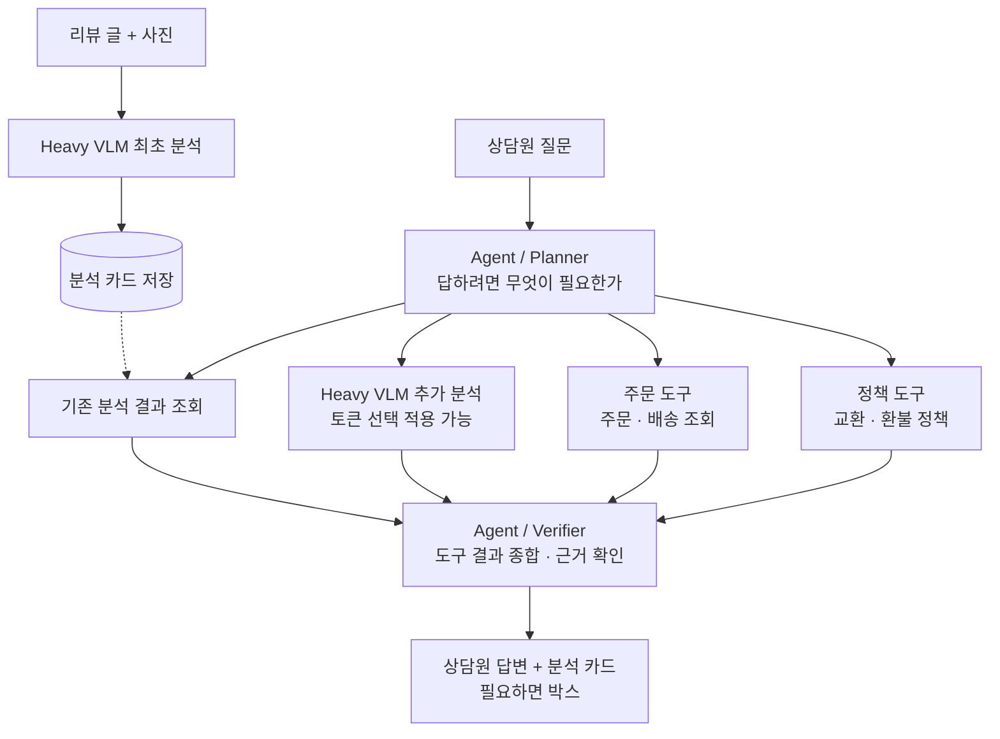

# 서비스 구조

8차 회의(11/10)에서 정리한 그림 그대로입니다. 지금은 틀만 있고, 베이스라인 실험을 맞춰 본 뒤 채웁니다.

## 칸별 역할

| 칸 | 하는 일 | 폴더 |
|---|---|---|
| Heavy VLM 최초 분석 | 리뷰 글 + 사진 → [분석 카드](agreements.md#2-출력-분석-카드) | `service/analysis/` |
| 분석 카드 저장 | 카드를 저장하고 다시 꺼내 씀 | `service/analysis/` |
| Agent / Planner | 질문을 이해하고 정함: 있는 정보로 충분한가 → VLM 추가 분석이 필요한가 → 외부 조회가 필요한가 | `service/agent/` |
| 기존 분석 결과 조회 | 저장된 카드 · 텍스트 분석 결과 | `service/tools/` |
| Heavy VLM 추가 분석 | 카드만으로 답하기 어려운 질문일 때 VLM을 다시 부름. Visual Token Selection 적용 가능 | `service/tools/` |
| 주문 도구 | 주문 · 배송 조회 (목업) | `service/tools/` |
| 정책 도구 | 교환 · 환불 정책 검색 (목업) | `service/tools/` |
| Agent / Verifier | 도구 결과를 종합하고 답변 근거를 확인 | `service/agent/` |
| API | 화면과 위 칸들을 잇는 서버 (FastAPI) | `service/api/` |
| 상담원 화면 | 분석 카드와 질문 답변을 보여줌 (React + TypeScript) | `web/` |
